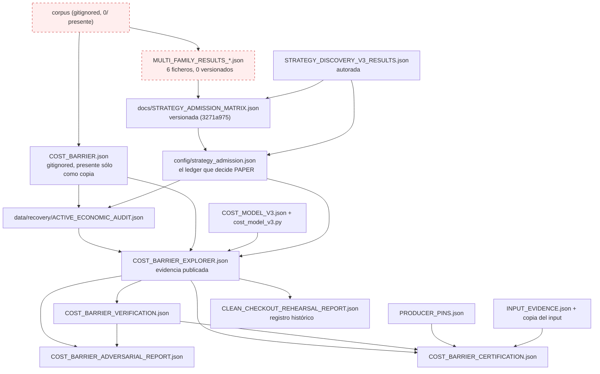

# WP-ECONOMIC-RECOVERY-003 — Grafo de dependencias de la evidencia económica

> Medido por [`scripts/wp_eco003_audit.py`](../../../../scripts/wp_eco003_audit.py) sobre
> `repro/economic-recovery-002` @ `2bd6e346`, 2026-10-25. El script **sólo lee**: hashea
> ficheros, ejecuta `git ls-tree`/`git show` y lanza el gate en `--check` (que a su vez no
> escribe). Los datos completos están en
> [`EVIDENCE_IMPACT_MATRIX.json`](EVIDENCE_IMPACT_MATRIX.json); este documento es su lectura.

---

## 1. Método, y qué mide exactamente

| columna | cómo se obtiene | por qué importa |
| --- | --- | --- |
| `producer` | declarado en el script de auditoría a partir de los `if __name__` y de los scripts que abren el fichero en modo escritura | sin productor no hay reconstrucción posible |
| `inputs` | declarados por el productor (lo que abre para leer) | una entrada ausente convierte el nodo en no reproducible |
| `sha256` | bytes **en disco** | es lo que hashea el gate |
| `sha256_lf` | los mismos bytes con `\r\n → \n` | distingue deriva de contenido de deriva de fin de línea |
| `committed_renderings` | `git show HEAD:<ruta>` hasheado en tres formas (`blob`, `lf`, `crlf`) | dice **qué** bytes nombra un pin: el blob, o lo que una máquina escribió |
| `consumers` | ficheros **versionados** cuyo texto contiene la ruta | se deriva, no se declara |
| `recert_effect` | clasificación de este WP | separa lo que la recertificación reescribe de lo que no toca |

Los consumidores se cuentan incluyendo documentación; un número alto no implica dependencia
ejecutable. La distinción se hace en §3 por tipo de nodo.

---

## 2. El grafo



Línea continua = dependencia declarada y verificada con un digest. Línea discontinua
(`corpus`, `mf`) = el nodo no existe en ningún checkout.

---

## 3. Nodos: productor, entradas, hash y consumidores

`hash` es el SHA-256 de los bytes en disco; `—` significa que el nodo **no existe** en este
árbol (declarado como ausencia, no como cero).

| # | id | ruta | tipo | productor | entradas | hash | consumidores | efecto recert. |
| - | -- | ---- | ---- | --------- | -------- | ---- | ------------ | -------------- |
| 1 | `corpus` | `reports/strategy-baseline/data/` | corpus de entrada | — (datos de exchange, cacheados) | klines 5m | — (**ausente**) | 35 | `NOT_TOUCHED` |
| 2 | `multi_family` | `reports/strategy-baseline/MULTI_FAMILY_RESULTS_*.json` | resultado | `scripts/multi_family_backtest.py` | `corpus` | — (**ausente**) | 5 | `NOT_TOUCHED` |
| 3 | `cost_barrier_input` | `reports/strategy-baseline/COST_BARRIER.json` | resultado | `scripts/cost_barrier.py` | `corpus` | — (ausente en el árbol; copia exacta en disco, ver §6) | 36 | `NOT_TOUCHED` |
| 4 | `criteria` | `docs/STRATEGY_ADMISSION_CRITERIA.md` | pre-registro | — (documento firmado en `c1ffbaa`) | — | `11369d7f099d` | 20 | `NOT_TOUCHED` |
| 5 | `matrix` | `docs/STRATEGY_ADMISSION_MATRIX.json` | evidencia derivada | `scripts/build_admission_matrix.py` | nodo 2 + `docs/EMA_CROSSOVER_PERFORMANCE_BASELINE.json` | `4e15882cd3b9` | 27 | `NOT_TOUCHED` |
| 6 | `v3_results` | `docs/STRATEGY_DISCOVERY_V3_RESULTS.json` | resultado | — (autorado; nada lo escribe) | `corpus` | `74024caf9b52` | 28 | `NOT_TOUCHED` |
| 7 | `ledger` | `config/strategy_admission.json` | configuración de runtime | `scripts/build_strategy_admission.py` | nodos 5, 6 | `5e2ccc5792b8` | 85 | `REBUILT_ALREADY` (WP-002) |
| 8 | `audit` | `data/recovery/ACTIVE_ECONOMIC_AUDIT.json` | evidencia derivada | `scripts/active_economic_audit.py` | nodos 3, 6, 7 + `docs/COST_MODEL_V3.json` | `8a101e8875bd` | 37 | `UNCHANGED_PAYLOAD` |
| 9 | `cost_model_doc` | `docs/COST_MODEL_V3.json` | documento de modelo | — (versionado, pinneado por contenido) | — | `2f0e62d2408e` | 38 | `NOT_TOUCHED` |
| 10 | `cost_model_module` | `src/trading_bot/research/microstructure/cost_model_v3.py` | código de modelo | — (el modelo ejecutable) | — | `bc7e27538b65` | 17 | `NOT_TOUCHED` |
| 11 | `input_evidence` | `data/recovery/wp7/evidence/INPUT_EVIDENCE.json` | bundle de evidencia | `scripts/cost_barrier_evidence.py` | nodo 3 | `c4afce3831a7` | 4 | `REBUILT` |
| 12 | `input_evidence_copy` | `data/recovery/wp7/evidence/COST_BARRIER.json` | copia de evidencia | `scripts/cost_barrier_evidence.py` | nodo 3 | `2437f446051d` | 9 | `UNCHANGED_PAYLOAD` |
| 13 | `producer_pins` | `data/recovery/wp7/evidence/PRODUCER_PINS.json` | bundle de evidencia | `scripts/cost_barrier_evidence.py` | 4 scripts productores | `a973fd41d638` | 9 | `REBUILT` |
| 14 | `explorer` | `data/recovery/COST_BARRIER_EXPLORER.json` | evidencia publicada | `scripts/cost_barrier_explorer.py` | nodos 3, 7, 8, 9, 10 | `02388981122d` | 15 | `UNCHANGED_PAYLOAD` |
| 15 | `verification` | `data/recovery/COST_BARRIER_VERIFICATION.json` | evidencia publicada | `scripts/cost_barrier_verify.py` | nodo 14 | `80c197b4e232` | 9 | `UNCHANGED_PAYLOAD` |
| 16 | `adversarial` | `data/recovery/wp7/COST_BARRIER_ADVERSARIAL_REPORT.json` | evidencia publicada | `scripts/cost_barrier_adversarial.py` | nodos 14, 15 | `350d239f5ec5` | 1 | `REBUILT` |
| 17 | `certification` | `data/recovery/wp7/COST_BARRIER_CERTIFICATION.json` | evidencia publicada | `scripts/cost_barrier_certify.py` | nodos 13, 14, 15, 16 (+ digest de 11) | `3a4e2bc05908` | 5 | `REBUILT` |
| 18 | `wp8_rehearsal` | `data/recovery/wp8/CLEAN_CHECKOUT_REHEARSAL_REPORT.json` | registro histórico | `scripts/clean_checkout_rehearsal.py` | nodo 14 | `f201d253f985` | 6 | `HISTORICAL_RECORD` |

Lectura de la columna de efecto:

- **`REBUILT`** (11, 13, 16, 17): su productor los reescribe en una recertificación. Los
  cuatro son bundles/actas, no números económicos.
- **`UNCHANGED_PAYLOAD`** (8, 12, 14, 15): se reconstruyen, pero el payload económico no
  cambia. Probado para el 14: el payload reconstruido es
  `4383d812…`, idéntico al publicado (§4 del informe final).
- **`NOT_TOUCHED`** (1-6, 9, 10): fuera del radio de la recertificación. Incluye todo lo que
  fija economía: criterios, matriz, modelo de costes, resultados.
- **`REBUILT_ALREADY`** (7): reescrito por WP-002; es el nodo que hoy deriva.
- **`HISTORICAL_RECORD`** (18): registra lo que observó en su propio commit; no es un pin vivo.

---

## 4. Pines: quién fija qué

21 pines declarados en tres publicadores. `estado` se recalcula; una fila `EXACT` con dos
digests distintos corresponde a un pin que acepta varias representaciones (LF/CRLF).

| ruta pinneada | publicada por | estado | pin | en disco |
| --- | --- | --- | --- | --- |
| `data/recovery/ACTIVE_ECONOMIC_AUDIT.json` | `sources[]` | **EOL_ONLY** | `e05be22b1b16` | `8a101e8875bd` |
| `reports/strategy-baseline/COST_BARRIER.json` | `sources[]` | **ABSENT** | `2437f446051d` | — |
| `config/strategy_admission.json` | `sources[]` | **DRIFT** | `6c4dd0be1fc2` | `5e2ccc5792b8` |
| `docs/COST_MODEL_V3.json` | `sources[]` | `EXACT` | `2f0e62d2408e` | `2f0e62d2408e` |
| `src/trading_bot/research/microstructure/cost_model_v3.py` | `sources[]` | `EXACT` | `bc7e27538b65` | `bc7e27538b65` |
| `data/recovery/COST_BARRIER_EXPLORER.json` | `evidence_digests` | `EXACT` | `02388981122d` | `02388981122d` |
| `data/recovery/COST_BARRIER_VERIFICATION.json` | `evidence_digests` | `EXACT` | `80c197b4e232` | `80c197b4e232` |
| `data/recovery/ACTIVE_ECONOMIC_AUDIT.json` | `evidence_digests` | `EXACT` | `8a101e8875bd` | `8a101e8875bd` |
| `data/recovery/wp7/evidence/COST_BARRIER.json` | `evidence_digests` | `EXACT` | `1547cea438d2` (LF) | `1547cea438d2` |
| `data/recovery/wp7/evidence/INPUT_EVIDENCE.json` | `evidence_digests` | `EXACT` | `20c45964842a` | `20c45964842a` |
| `data/recovery/wp7/evidence/PRODUCER_PINS.json` | `evidence_digests` | `EXACT` | `b57e3f622d9d` | `b57e3f622d9d` |
| `scripts/cost_barrier_gate.py` | `evidence_digests` | `EXACT` | `8707fb90d042` | `8707fb90d042` |
| `scripts/cost_barrier_evidence.py` | `evidence_digests` | `EXACT` | `6ab4cc400f9d` | `6ab4cc400f9d` |
| `scripts/cost_barrier_adversarial.py` | `evidence_digests` | `EXACT` | `c56c2049d97a` | `c56c2049d97a` |
| `scripts/cost_barrier_explorer.py` | `evidence_digests` | `EXACT` | `b2bc66da0259` | `b2bc66da0259` |
| `scripts/cost_barrier_verify.py` | `evidence_digests` | `EXACT` | `a43fe404dec4` | `a43fe404dec4` |
| `.github/workflows/cost-barrier-gate.yml` | `evidence_digests` | `EXACT` | `fae181321e4e` | `fae181321e4e` |
| `scripts/active_economic_audit.py` | `producers[]` | `EXACT` | `6c4fbd8093a7` | `6c4fbd8093a7` |
| `scripts/cost_barrier.py` | `producers[]` | `EXACT` | `03c69a01232a` | `2c9ed4e053f4` (LF aceptado) |
| `scripts/cost_barrier_explorer.py` | `producers[]` | `EXACT` | `b2bc66da0259` | `b2bc66da0259` |
| `scripts/cost_barrier_verify.py` | `producers[]` | `EXACT` | `a43fe404dec4` | `a43fe404dec4` |

Los tres estados que no son exactos son de naturaleza distinta y **no** se arreglan igual
(§5). El gate actual, en `--check`:

```
cost-barrier drift gate: INTEGRITY_FAILURE (check mode) exit 5
  checks 10/11 PASS · controls 6/6
  [FAIL] inputs:published_pins_match_the_declared_sources
         config/strategy_admission.json content drift (pin 6c4dd0be1fc2...)
```

---

## 5. Qué bytes nombra cada pin (la patología, medida)

El pin del ledger **no es el digest de ningún blob commiteado**. Es el digest de su
representación CRLF:

| revisión | blob (LF) | CRLF | ¿es el pin? |
| --- | --- | --- | --- |
| `ddaf14d1` (`2026-09-28`, ledger vigente cuando se publicó el explorer) | `92aab541…` | **`6c4dd0be…`** | sí |
| `eb53e631` (`2026-10-25`, reparación del ancla en WP-002) / `HEAD` | `5e2ccc57…` | `21a642de…` | no |

Dos defectos compuestos en un solo valor:

1. **convención** — el explorer hasheó los bytes de una *copia de trabajo Windows*
   (`\r\n`) del blob LF. Ningún checkout produce esos bytes hoy: `config/strategy_admission.json`
   está fijado con `-text` en [`.gitattributes`](../../../../.gitattributes) desde `eb53e631`.
   Antes de la reparación esto se toleraba como `line-ending-only`; dejó de ser benigno
   cuando el contenido cambió.
2. **contenido** — el documento que hay que fijar es el del ledger reparado (`5e2ccc57`),
   no el del ancla caducada.

El mismo patrón aparece en `data/recovery/ACTIVE_ECONOMIC_AUDIT.json`: su pin
`e05be22b…` es el CRLF de `8a101e88…`. Ahí es **inofensivo** porque el explorer publica
además un `state_sha256` semántico (`023b66ff…`, commit `279d73f3`: *"pin what the audit
states, not the bytes one machine happened to write"*), y el gate lo acepta como
`state-exact`. El ledger **no tiene** ese pin de estado (`state_sha256: null`), así que su
única protección es el byte pin roto. Ésa es la asimetría que WP-004 debe cerrar.

---

## 6. El input que falta sí está: cadena de custodia del `COST_BARRIER.json`

`reports/strategy-baseline/COST_BARRIER.json` está gitignoreado (`.gitignore:55 reports/*`)
y no existe en este checkout. Pero su copia de evidencia **es byte-idéntica** y el
materializador la restaura sin transformar:

| objeto | sha256 | bytes |
| --- | --- | --- |
| pin del explorer (`sources[]`) | `2437f446051d…` | 3822 |
| copia `data/recovery/wp7/evidence/COST_BARRIER.json` | `2437f446051d…` | 3822 |
| tras `cost_barrier_evidence.py --materialize` | `2437f446051d…` | 3822 |
| digest LF registrado por la certificación | `1547cea438d2…` | — |

Conclusión: el bundle del cost-barrier **sí** es reproducible sin el corpus congelado. Lo
que no es reproducible es la capa `MULTI_FAMILY_RESULTS` (nodo 2), que no tiene copia en
ninguna parte del repositorio (ver
[`SOURCE_RECOVERY_ASSESSMENT.md`](SOURCE_RECOVERY_ASSESSMENT.md)).

---

## 7. Información ausente, declarada

| nodo | qué falta | consecuencia |
| --- | --- | --- |
| `corpus` (1) | los datasets y cualquier digest suyo | ningún resultado derivado del corpus puede reconstruirse byte a byte; sólo re-ejecutarse como experimento nuevo |
| `multi_family` (2) | los 6 ficheros, su digest y cualquier manifiesto que los cite con hash | la matriz de admisión (5) es el **único** registro de esas métricas |
| `matrix` (5) | no contiene ni un digest de sus entradas (`sha256` no aparece en el documento), ni commit, ni date de construcción | no se puede demostrar qué resultados la produjeron |
| `v3_results` (6) | no tiene productor en el repositorio | no es reconstruible; es un documento autorado |
| `certification` (17) | su `candidate.environment` nombra la ruta absoluta del intérprete de la máquina que certificó | el registro no es portable, aunque los digests sí lo son |

Ninguna de estas ausencias se sustituye por un valor inventado en este WP.
